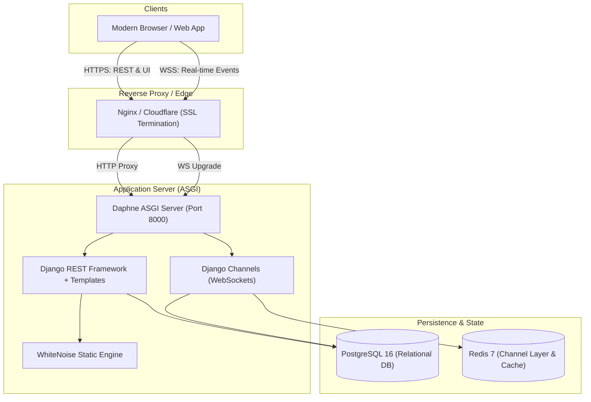

# DevTask

<div align="center">

[](https://www.python.org/downloads/)
[](https://www.djangoproject.com/)
[](https://www.django-rest-framework.org/)
[](https://channels.readthedocs.io/)
[]()
[](https://github.com/astral-sh/ruff)
[](LICENSE)

**A high-performance team task and project management platform inspired by Linear and Trello.**  
*Engineered with Django 5, Django REST Framework, Django Channels, PostgreSQL, and Redis.*

[Live Features](#key-features) • [Architecture](#system-architecture) • [Quickstart](#local-development-setup) • [Docker Deployment](#docker--docker-compose-deployment) • [API Docs](#api-reference--documentation) • [Benchmarking](#performance-benchmarking--load-testing)

</div>

---

## Overview

**DevTask** delivers a production-grade, full-stack collaborative workspace. It combines an ultra-fast REST backend, real-time WebSocket synchronization across project collaborators, an optimistic Kanban drag-and-drop board, comprehensive role-based access control (`OWNER`, `MANAGER`, `MEMBER`), and strict object-level authorization (IDOR protection).

---

## Key Features

- 🎯 **Linear & Trello-Style Kanban**:
  - Drag-and-drop task movement across `TODO`, `IN_PROGRESS`, and `DONE` columns.
  - Sub-millisecond optimistic UI updates with automatic rollback on network disruption.
  - Accessible keyboard and dropdown-based column reassignment fallbacks.
  - Automatic completion timestamps (`completed_at`) and card position re-indexing.
- ⚡ **Real-Time WebSocket Synchronization**:
  - Bi-directional WebSockets via Daphne and Django Channels.
  - Project-scoped event channels (`project_<id>`) preventing cross-project event leakage.
  - Handshake authentication and project membership verification.
  - Resilient browser client with exponential backoff and auth failure loop protection (`4001` / `4003`).
- 👥 **Team & Role-Based Permissions (RBAC)**:
  - Multi-tenant workspace isolation.
  - Three distinct roles: `OWNER` (full administrative rights), `MANAGER` (project & task administration), and `MEMBER` (collaborator).
  - Explicit IDOR protection: non-members cannot read, modify, or infer project existence.
- 💬 **Collaborative Discussions & Activity Stream**:
  - Markdown-ready task discussions and comment threads.
  - Automatic audit trail (`ActivityLog`) capturing task mutations, assignments, and member events.
- 🚀 **High-Throughput Database Optimization**:
  - Constant-time query complexity ($O(1)$) across lists and dashboards using `select_related()` and `prefetch_related()`.
  - Composite PostgreSQL indexes on high-frequency lookup fields (`status`, `priority`, `assignee`, `due_date`).
  - Connection pooling with health checks enabled (`conn_max_age=600`).
- 🛡️ **Hardened Production Security**:
  - Zero hardcoded secrets; strict environment variable separation.
  - HTTPS enforcement, HSTS, Secure/HttpOnly/SameSite session and CSRF cookies.
  - Custom branded error views (`404.html`, `403.html`, `500.html`) and sanitized API 500 error handlers.
  - Active deployment health check endpoint at `/health/`.

---

## System Architecture



---

## Project Structure

```text
devtask/
├── accounts/                  # User accounts, registration, profiles, and authentication
│   ├── api_views.py           # REST auth endpoints (register, login, logout, me)
│   ├── models.py              # UserProfile and custom avatar fields
│   └── serializers.py         # Auth serializers with strict validation
├── projects/                  # Workspace projects, memberships, and role permissions
│   ├── api_views.py           # REST project viewsets, member management, ownership transfer
│   ├── models.py              # Project and ProjectMembership models
│   ├── permissions.py         # Object-level permission guards (is_project_member, etc.)
│   └── services.py            # Optimized aggregation queries and statistics
├── tasks/                     # Tasks, Kanban board, comments, activity logs, WebSockets
│   ├── api_views.py           # Task CRUD, Kanban reordering, comment streams
│   ├── consumers.py           # AsyncJsonWebsocketConsumer with auth & project guards
│   ├── models.py              # Task, TaskComment, and ActivityLog models
│   └── routing.py             # WebSocket routing configuration
├── config/                    # Django core configuration & settings
│   ├── asgi.py                # ASGI application with Channels ProtocolTypeRouter
│   ├── settings/
│   │   ├── base.py            # Shared settings, apps, logging, DRF configuration
│   │   ├── development.py     # Local dev settings (SQLite, InMemory channel layer, DEBUG=True)
│   │   └── production.py      # Hardened production settings (SSL, HSTS, WhiteNoise, PostgreSQL)
│   ├── urls.py                # Root URL routing, Swagger docs, health check
│   └── exceptions.py          # Production exception sanitizer & error logger
├── templates/                 # Server-rendered HTML views (Dashboard, Board, Auth, Custom 404/403/500)
├── static/                    # Frontend styling (Dark theme CSS) and JavaScript (Kanban board engine)
├── loadtests/                 # Locust load testing suites, profiling scripts, and query explainers
│   ├── locustfile.py          # Authenticated Locust scenario suite
│   ├── explain_postgres.py    # PostgreSQL EXPLAIN ANALYZE verification script
│   └── profile_endpoints.py   # Latency and query count profiler
├── tests/                     # Automated test suites (50 tests covering auth, IDOR, tasks, deployment)
├── compose.yaml               # Docker Compose multi-container deployment configuration
├── Dockerfile                 # Multi-stage production container definition
├── docker-entrypoint.sh       # Automated migration and server startup entrypoint
├── requirements.txt           # Python package dependencies
└── pyproject.toml             # Ruff linter and code style configuration
```

---

## Local Development Setup

### 1. Prerequisites
- **Python**: 3.12 or newer
- **Git**
- **Redis** (optional, recommended for multi-worker WebSocket testing; defaults to in-memory channel layer locally)

### 2. Clone the Repository
```bash
git clone https://github.com/uddyalokb700-cmk/DevTask.git
cd DevTask
```

### 3. Virtual Environment Setup
```bash
python3 -m venv .venv
source .venv/bin/activate

# Upgrade pip and install dependencies
pip install --upgrade pip
pip install -r requirements.txt
```

### 4. Environment Configuration
Copy the sample environment file:
```bash
cp .env.example .env
```
*Note: In local development, leaving `DATABASE_URL` commented out automatically defaults to SQLite (`db.sqlite3`).*

### 5. Apply Database Migrations
```bash
# Verify no pending unmigrated model changes
python manage.py makemigrations --check --dry-run

# Run migrations
python manage.py migrate

# Create an administrative superuser
python manage.py createsuperuser
```

### 6. Start the Server
Start DevTask using the **Daphne** ASGI server (recommended for full WebSocket support):
```bash
daphne -b 127.0.0.1 -p 8000 config.asgi:application
```
*(Or alternatively run `python manage.py runserver 127.0.0.1:8000`)*

Open **[http://127.0.0.1:8000/](http://127.0.0.1:8000/)** in your browser to start using DevTask.

---

## Docker & Docker Compose Deployment

DevTask includes a production-ready container stack comprising **Daphne**, **PostgreSQL 16**, and **Redis 7** with built-in health checks.

### 1. Configure Environment
```bash
cp .env.example .env
```
Ensure production variables are set in `.env`:
```ini
DJANGO_SETTINGS_MODULE=config.settings.production
DJANGO_SECRET_KEY=use-a-strong-secret-key-at-least-50-characters-long
DJANGO_ALLOWED_HOSTS=localhost,127.0.0.1,web
DJANGO_CSRF_TRUSTED_ORIGINS=http://localhost:8000,http://127.0.0.1:8000
POSTGRES_DB=devtask_db
POSTGRES_USER=devtask_user
POSTGRES_PASSWORD=devtask_secure_password
DJANGO_SECURE_SSL_REDIRECT=False
DJANGO_SESSION_COOKIE_SECURE=False
DJANGO_CSRF_COOKIE_SECURE=False
```

### 2. Build and Launch
```bash
docker compose up --build -d
```

### 3. Verify Container Status
```bash
docker compose ps
```
The database and redis containers perform continuous health checks (`pg_isready` and `redis-cli ping`). The `web` container automatically applies all database migrations via `docker-entrypoint.sh` before Daphne starts listening.

### 4. Create Admin User inside Container
```bash
docker compose exec web python manage.py createsuperuser
```

---

## Automated Tests & Quality Assurance

DevTask features an automated test suite with **50 tests** passing cleanly:

```bash
# Run complete test suite
.venv/bin/pytest

# Run tests with verbose output
.venv/bin/pytest -v

# Run deployment and end-to-end integration tests
.venv/bin/pytest tests/test_deployment.py -v
```

### Linter & Code Style
```bash
# Run Ruff linting check
.venv/bin/ruff check .
```

### Django Production Deployment Verification
Run Django's built-in deployment security verification against `config.settings.production`:
```bash
DJANGO_SECRET_KEY="temporary-secret-key-at-least-50-characters-long" \
DJANGO_ALLOWED_HOSTS="localhost,127.0.0.1" \
.venv/bin/python manage.py check --deploy --settings=config.settings.production
```
*Result: Zero security warnings or errors.*

---

## Performance Benchmarking & Load Testing

DevTask provides automated load-testing and query-profiling tools located in `loadtests/`:

### 1. Populate Synthetic Performance Data
```bash
python manage.py seed_performance_data --projects 20 --tasks 500
```

### 2. Run Headless Locust Load Test
```bash
locust -f loadtests/locustfile.py \
       --headless \
       -u 50 \
       -r 10 \
       --run-time 1m \
       --host http://127.0.0.1:8000
```

### 3. Measure Endpoint Query Counts & Execution Times
```bash
python loadtests/profile_endpoints.py
```

### 4. Inspect PostgreSQL Execution Plans
```bash
python loadtests/explain_postgres.py
```

---

## API Reference & Documentation

Interactive API documentation is generated using **drf-spectacular**:

- **Swagger UI**: [http://127.0.0.1:8000/api/docs/](http://127.0.0.1:8000/api/docs/)
- **ReDoc**: [http://127.0.0.1:8000/api/redoc/](http://127.0.0.1:8000/api/redoc/)
- **OpenAPI Schema (YAML)**: [http://127.0.0.1:8000/api/schema/](http://127.0.0.1:8000/api/schema/)

### Core REST Endpoints Summary

| Method | Endpoint | Description | Auth Required |
|---|---|---|---|
| `POST` | `/api/auth/register/` | Register a new user account | No |
| `POST` | `/api/auth/login/` | User authentication & session start | No |
| `POST` | `/api/auth/logout/` | Terminate session | Yes |
| `GET` | `/api/auth/me/` | Fetch current user profile & avatar color | Yes |
| `GET` | `/api/projects/` | List user's active projects (paginated) | Yes |
| `POST` | `/api/projects/` | Create a new project workspace | Yes |
| `GET` | `/api/projects/{id}/` | Retrieve project details with members | Yes |
| `POST` | `/api/projects/{id}/members/` | Add member to project (`MANAGER` / `OWNER` only) | Yes |
| `POST` | `/api/projects/{id}/archive/` | Archive or unarchive project (`OWNER` only) | Yes |
| `GET` | `/api/tasks/?project_id={id}` | Filter & paginate project tasks | Yes |
| `POST` | `/api/tasks/` | Create a new task | Yes |
| `PATCH` | `/api/tasks/{id}/` | Update task details or assignment | Yes |
| `POST` | `/api/tasks/{id}/reorder/` | Reorder task column & Kanban position | Yes |
| `GET` | `/api/tasks/{id}/comments/` | List task comment discussion stream | Yes |
| `POST` | `/api/tasks/{id}/comments/` | Add a comment to task | Yes |
| `GET` | `/api/projects/{id}/activity/`| Project activity audit logs | Yes |
| `GET` | `/health/` | Deployment connectivity health check | No |

---

## Production Deployment Guide

### Reverse Proxy Configuration (Nginx)

When deploying behind Nginx or an AWS Application Load Balancer (ALB), configure both standard HTTP request forwarding and WebSocket connection upgrade handling:

```nginx
upstream devtask_backend {
    server 127.0.0.1:8000;
}

server {
    listen 80;
    server_name yourdomain.com;
    return 301 https://$host$request_uri;
}

server {
    listen 443 ssl http2;
    server_name yourdomain.com;

    ssl_certificate /etc/letsencrypt/live/yourdomain.com/fullchain.pem;
    ssl_certificate_key /etc/letsencrypt/live/yourdomain.com/privkey.pem;

    client_max_body_size 25M;

    # HTTP API & Web Views
    location / {
        proxy_pass http://devtask_backend;
        proxy_set_header Host $host;
        proxy_set_header X-Real-IP $remote_addr;
        proxy_set_header X-Forwarded-For $proxy_add_x_forwarded_for;
        proxy_set_header X-Forwarded-Proto $scheme;
    }

    # WebSocket Real-Time Channel Proxy
    location /ws/ {
        proxy_pass http://devtask_backend;
        proxy_http_version 1.1;
        proxy_set_header Upgrade $http_upgrade;
        proxy_set_header Connection "upgrade";
        proxy_set_header Host $host;
        proxy_set_header X-Real-IP $remote_addr;
        proxy_set_header X-Forwarded-For $proxy_add_x_forwarded_for;
        proxy_set_header X-Forwarded-Proto $scheme;
        proxy_read_timeout 86400s;
        proxy_send_timeout 86400s;
    }
}
```

---

## Health Check & Monitoring

DevTask provides an active database health check endpoint at `/health/`:

- **Healthy (HTTP 200)**:
  ```json
  {
    "status": "ok",
    "database": "healthy"
  }
  ```
- **Unhealthy (HTTP 503)**:
  ```json
  {
    "status": "error",
    "database": "unhealthy"
  }
  ```

*(Internal database exception traces are masked when `DEBUG=False` to prevent sensitive infrastructure leaks).*

---

## License

This project is licensed under the [MIT License](LICENSE).